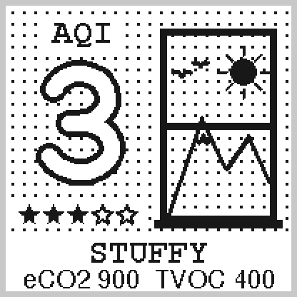

# 🪟 空気質画面（大きな AQI の数字と、換気をうながす上げ下げ窓）

## 📋 概要
ENS160 の AQI（1〜5）を、大きな白抜きの数字と星で見せる画面です（画面0: Air Quality）。右の上げ下げ窓は、空気が悪くなると開いて「換気しよう」と伝えます。

ENS160 の eCO2・TVOC・AQI は、どれも同じセンサー（金属酸化物）の値から計算されていて、一緒に上がり下がりします（eCO2 は本物の CO2 ではなく、TVOC から推定した値。AQI は TVOC の濃度で決まる）。なので画面は分けずに AQI を主役にして、eCO2 と TVOC は下に小さく出します。

ガス画面（[GAS_SCREEN.md](GAS_SCREEN.md)）は「いつもと違うガスが出ている」という急な異変、この画面は「部屋の空気がこもってきた」という毎日のゆっくりした変化を見る画面です。

---

## 🎨 デザイン

AQI 3 の場合：



- 窓の外はいつも晴れ（太陽と雪の山と鳥）
- 部屋全体（窓ガラスも）に点々のもや

### 見方

| AQI | ENS160 の区分 | 星 | もや（点の間隔） | 窓 | 下の文字 |
|---|---|---|---|---|---|
| 1 | Excellent | ★★★★★ | なし（ガラスにきらめき） | 閉じている | `FRESH` |
| 2 | Good | ★★★★☆ | 12px | 閉じている | `GOOD` |
| 3 | Moderate | ★★★☆☆ | 8px | 閉じている | `STUFFY` |
| 4 | Poor | ★★☆☆☆ | 6px | 下の窓を少しだけ上げる（すき間 17px） | 黒地に白で `OPEN!` |
| 5 | Unhealthy | ★☆☆☆☆ | 5px | 下の窓を上まで上げて全開（すき間 61px） | 黒地に白で `OPEN!!` |

- もやは、窓ガラスも含めた部屋全体にかかる。窓の外の景色は、どの AQI でも晴れのまま（外の空気はきれい、という意味）
- AQI 4・5 では、開いたすき間と、そこから左へ吹きこむ風の通り道だけもやが晴れる。風の線は大きな数字の後ろを通り、数字に吹きつけて見える（AQI 4 は2本、AQI 5 は通り道を太くして3本）
- 星の数は `6 − AQI`。AQI 1 で5つ、AQI 5 で1つ

### ウォームアップ中

ENS160 は、電源を入れてから約3分間はウォームアップ中、新品を初めて使うときは約1時間の初回起動中で、その間の値は正しくありません。そのあいだは数字の代わりに `?`、窓には閉じたブラインド、下に `WARMING UP` を出します（星と eCO2・TVOC は出さない）。

- ブラインドの羽根は10枚。進み具合が 10% 進むごとに1枚ずつ上がり、ブラインドそのものがゲージになる
- 進み具合は `begin()` してからの時間で出す（ウォームアップは3分、初回起動は60分で 100%）。センサーは残り時間を教えてくれないので目安
- 時間を過ぎても、センサーの有効フラグが通常に戻るまでは最後の1枚を残す。戻ったら AQI の画面に変わる
- 起動直後でまだ一度も測れていない（AQI が 0）ときも、ブラインドを出す

画面がこの画面に回ってきたときに描き直すので、羽根が上がって見えるのは表示した回だけです。既定（10画面を10秒ごと）なら3分の間に2回ほど、表示する画面を減らしていればもっと細かく上がっていきます。

---

## 🔧 技術実装

### ヘッダー宣言 (`display_screens.h`)
```cpp
// 画面0: Air Quality (空気質)
void displayAirQuality(const ENS160Data& ens160_data, bool sensor_enabled);
```

### ドライバ (`Custom_ENS160.h` / `Custom_ENS160.cpp`)
`ENS160Data` に、この画面で使う値を2つ足しています。

```cpp
uint8_t validity;        // 値の有効フラグ（ENS160_VALIDITY_*）
float warmup_progress;   // ウォームアップ（初回起動）の進み具合（0〜1。1 で完了）
```

- 有効フラグは、DATA_STATUS レジスタ（0x20）の bit 3〜2。0 = 通常、1 = ウォームアップ中、2 = 初回起動中、3 = 無効
- ScioSense のライブラリには読む関数がないので、`CustomENS160::readValidity()` で I2C から直接読む
- `begin()` でライブラリがセンサーをリセットするので、そこからウォームアップが始まる。その時刻を `start_time` に取っておく

### 描画 (`display_screens.cpp`)

| 部品 | 描き方 |
|------|-------|
| 窓 | 外側 (108, 16) から 82×136 の 5px の枠。内側（113, 21 から 72×126）がガラス。閉じているときは y=82 に 5px の合わせ目。窓台は (104, 150) から 90×6 |
| 開けた窓 | 上げた下の窓の桟（4px）を描く。AQI 4 は y=60 と y=126（ガラスごしに y=83 の上の窓の合わせ目が 3px で見える）、AQI 5 は y=82（上の桟は枠に隠れる）。桟より下がすき間（`AQ_OPENINGS`） |
| 景色 | 太陽は天気画面の `drawSun()`。山の稜線と雪の縁は丸いペン（`drawRoundLine()`、太さ 3px）、鳥は2次ベジェ曲線（`drawCurve()`）。位置はガラスの幅・高さに対する % |
| もや | 2×2px の点を、AQI ごとの間隔（`AQ_HAZE_STEP`）で y=160 まで打つ。開けた窓のすき間と、風の通り道の中には打たない |
| 風の通り道 | 窓の側（x=112）と左端（x=0）での上端・下端の y を、smoothstep でなめらかにつなぐ（`windBand()`） |
| 風の線 | (104, y0) から (10, y1) へ、2次ベジェ曲線を3つつないで山と谷を交互に描く（太さ 5px）。左端に矢じり（`drawWindLine()`） |
| 大きな数字・`?` | 月日画面の丸ゴシックの中心線を、外形 64×88（左上 (20, 38)）で描く。半径 9 の黒いペンで全部なぞってから、同じ中心線を半径 5 の白いペンでなぞって白抜きにする（`drawGlyph()`）。`?` の中心線も月日画面の数字と同じ形式で足した（`GLYPH_Q`） |
| 星 | 外と内の頂点が交互の10角形。塗りは中心からの三角形10個、輪郭は 2px の線（`drawStar()`）。白い台（(4, 136) から 92×20）の上に x=16 から 17px おき |
| `AQI` の文字・下の帯 | 全画面共通の `FreeMonoBold12pt7b`。`AQI` は白い台の上。eCO2・TVOC は天気画面などで使っている `FreeSans9pt7b` |
| ブラインド | ガラスの上 6px がレール、その下に 12px の羽根を10枚（上の 2px の線で区切る）。下の端に 5px の重り。ひもは左寄り（x=117） |

座標は画面の座標でそのまま書いています。画像もフォントも増やしていません。

ほかの画面と共通の部品は、次のように広げました（今までの呼び出しは、そのままで同じ絵になります）。

- `drawRoundLine()` に色の引数を足した（既定は黒。白抜きの数字の白いペンに使う）
- `drawCurve()` にペンの半径の引数を足した（既定は 1 で、カナリアの線と同じ）
- 月日画面の `drawDigitInCell()` の中身を `drawGlyph()` に分けて、外形の大きさと白抜きの縁の太さを指定できるようにした

### 呼び出し (`main.cpp`)
```cpp
case 0:
  displayAirQuality(ens160_data, sensor_ens160_enabled);
  break;
```

ENS160 がないときは、今までどおり `Air Quality / ENS160 / Not / Connected` と表示します。前の画面で使っていた `getAQIStatusEnglish()` は使わなくなったので消しました。

ウォームアップ中は、シリアルに有効フラグと進み具合も出します。

```
  eCO2: 839 ppm
  TVOC: 415 ppb
  AQI : 3 (中程度)
  ⏳ ENS160 準備中（有効フラグ 1、進み具合 8%）
```

---

## 📦 容量

この画面に変える前の main（`62a20a2`）と比べた値です。

| | main | この画面に変更 | 差 |
|---|---|---|---|
| Flash | 940,442 B | 945,006 B | **+4,564 B** |
| RAM | 47,036 B | 47,052 B | **+16 B** |

このうちウォームアップ中のブラインドと `?` は約 460 B です（ブラインドを描かないようにしてビルドした値との差）。羽根は進み具合から計算してループで描くので、羽根の枚数を変えても容量はほとんど変わりません。

---

## ✅ 確認状況

- ✅ ビルドが通ること
- ✅ PC 上で同じ座標を描いたプレビューで、ウォームアップ（0%・55%・85%）と AQI 1〜5 の8つが重ならずに描けること
- ✅ 実機に書き込み、ウォームアップ中に画面0を表示してもエラーやリセットが出ないこと
- ✅ 実機で、起動直後に有効フラグ 1（ウォームアップ中）が読めて、進み具合が10秒で約5%ずつ進むこと
- ✅ 実機で、約3分後に有効フラグが 0 に戻ること（シリアルの「準備中」の行が消える）
- ✅ 実機で、ウォームアップ中はブラインドが出て、終わると窓の画面に変わること（2026-10-17、目視）
- ✅ 実機で、AQI 3 と AQI 4 のときに画面0を表示しても、エラーやリセットが出ないこと
- ✅ 実機で、お酒を飲んだ息を吹きかけると AQI 5 まで上がり、画面も AQI 5 の表示になること（2026-10-17、目視）
