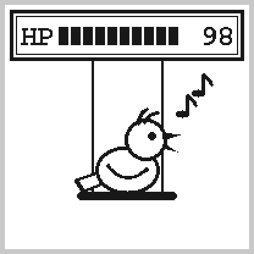

# 🐤 ガスセンサー画面（炭鉱のカナリアと RPG 風の HP ゲージ）

## 📋 概要
昔の炭鉱では、有毒ガスに早く気づくためにカナリアを連れて入っていました。その話に見立てて、MICS5524 の Rs/Ro を「カナリアの HP」として出す画面です（画面3: Gas Sensor）。HP が減るほど、カナリアが弱っていきます。

MICS5524 はガスの種類を区別できず、アルコール・一酸化炭素・水素・アンモニアなどにまとめて反応します（[MICS5524_INTEGRATION.md](MICS5524_INTEGRATION.md)）。ガス警報器の代わりにはならないので、HP は「空気がどれくらいいつもと違うか」の目安として見てください。

---

## 🎨 デザイン

HP が 98 の場合：



- 上は RPG 風のウィンドウ（二重線の枠）。ゲージは10マス
- ブランコに乗って歌うカナリア

### 見方

| HP | カナリア |
|---|---|
| 70〜100 | ブランコに乗って、くちばしを開けて歌う（音符が2つ） |
| 30〜69 | うなだれて目が半分閉じ、冷や汗をかく。まわりににおいの線 |
| 0〜29 | 止まり木から落ちて、床でひっくり返る（× 目で足が上）。空のブランコだけが揺れている |

- ゲージは1マスが HP 10。HP が 1 でも残っていれば1マス出す
- 数字は HP（0〜100）。単位はつけない
- しきい値は `display_screens.cpp` の `CANARY_HP_SING`（70）と `CANARY_HP_FAINT`（30）

### ウォームアップ中（起動から3分間）

上の枠に `WARMING UP` と出し、下に温められている卵（上に熱の線）を描きます。卵のひびが左からのびていき、3分でのび切ってキャリブレーションが済むと、カナリアに変わります。

ひびの長さが変わるのは、画面がガス画面に回ってきたときだけです。ほかの画面と切り替えながら表示するので、3分の間に卵が見えるのは1〜2回で、ひびはとびとびにのびて見えます。

---

## ❤️ HP の計算

```
HP = (Rs/Ro − 下限) ÷ (1 − 下限) × 100    （0〜100 に収める）
```

- Rs/Ro が 1（直近8日でいちばんきれいだったときの空気。下の「基準（Ro）の補正」）で HP 100
- 下限は、ガスが濃くて、センサーの出力が ADC の上限（4095）に達したときの Rs/Ro。それより下は測れないので、そこを HP 0 にする
  - 下限 = RL × (5V − 上限電圧) ÷ 上限電圧 ÷ Ro（上限電圧は `adcRawToVolts(4095)`）。`MICS5524Data::rs_ro_min`
  - 実機（2026-10-17）では 4095 が約 2.9V に当たり、下限の Rs は約 7.2kΩ。Ro ≈ 104kΩ のとき下限 ≈ 0.07
- HP は Rs/Ro に比例させているだけなので、ガスの濃度には比例しない（センサーの抵抗は濃度に対して対数的に下がる）。うすいガスで HP がすっと減り、濃くなるほど減り方がゆるやかになる

実機（Ro ≈ 104kΩ、下限 ≈ 0.07）での目安：

| 空気 | Rs/Ro | HP | カナリア |
|---|---|---|---|
| 直近8日でいちばんきれいだったとき | 1.00 | 100 | 歌う |
| HP 70 の境目 | 約 0.72 | 70 | 歌う ↔ しょんぼり |
| お酒を飲んだ息を吹きかけたとき（1回目） | 0.56 | 約 53 | しょんぼり |
| HP 30 の境目 | 約 0.35 | 30 | しょんぼり ↔ ひっくり返る |
| お酒を飲んだ息を吹きかけたとき（2回目） | 約 0.35 未満 | 30 未満 | ひっくり返る |

息の当たり方で下がり方は大きく変わります。

シリアルモニターの `Rs/Ro比` の行には、今の Ro と下限も出します（例: `Rs/Ro比: 0.560（Ro 103803 Ω、測れる下限 0.069）`）。

### 基準（Ro）の補正

Ro（HP 100 の基準）は、起動して3分たったときの Rs から始めて、その後は**直近8日でいちばんきれいだったとき（Rs がいちばん大きかったとき）の Rs** に合わせます。

- 1日ごとのいちばん大きい Rs を8日分覚えておき、その最大を Ro にする。10秒ごとの読み取りのたびに更新し、1日たつごとに一番古い日の分を捨てる
- 汚れた空気の中で起動しても、きれいな空気が一度来れば、そこが HP 100 になる
- 何日も汚れたままでも、約1週間はきれいだったときが基準のまま残るので、HP が低いまま出る
- それより長く続くずれ（センサーの値のずれや、季節による湿度の変化）は、8日たつと吸収される
- 一番新しい分は途中の「今日」なので、8日分あれば必ず丸7日以上を見られる（7日分だと、6日と今日の途中までしか見られないことがある）
- Ro は直近の最大なので、Rs/Ro は 1 を超えない（次の、基準に入れなかったときを除く）
- 出力が 0.1V 未満（Rs 約 490kΩ 以上）のときは、基準に入れない（`MIN_BASELINE_VOLTAGE`。キャリブレーションも同じ）
  - コネクタの抜けかけなどで出力が下がると、Rs が実際よりずっと大きく計算される。それが Ro になると8日間残り、元に戻っても HP がほぼ 0 のままになる
  - PC 上のシミュレーションでは、0.05V が30秒（3回）続くと Ro ≈ 984kΩ になり、戻った後の Rs/Ro ≈ 0.10（HP 約10）だった。下限を入れた後は Ro がそのまま残り、戻った後の Rs/Ro は 1.00
  - この個体のきれいな空気は約 0.44V（Ro ≈ 104kΩ）なので、4倍以上の余裕がある。起動したときに出力が 0.1V 未満ならキャリブレーションできず、卵のまま待つ
- 「1日」は起動（またはキャリブレーション）した時刻から24時間ごとに区切る（0時ではない）
- 記録は RAM にだけ持つので、再起動すると消えて、起動したときの Rs から数え直す。設定ページの「今の空気を基準にする」を押したときも、記録を捨てて今の Rs から始める
- 日数は `Custom_MICS5524.h` の `RO_DAYS`（8）。RAM は float 4個（16B）単位で取られるので、7日分にしても使う量は同じ

---

## 🔧 技術実装

### ヘッダー宣言 (`display_screens.h`)
```cpp
// 画面3: Gas Sensor (ガスセンサー)
void displayGasSensor(const MICS5524Data& mics5524_data, bool sensor_enabled);
```

### ドライバ (`Custom_MICS5524.h`)
`MICS5524Data` に、この画面で使う値を3つ足しています。

```cpp
float ro;                // 今の基準の抵抗 Ro（Ω。キャリブレーション前は 0）
float rs_ro_min;         // 測れる Rs/Ro の下限（出力が ADC の上限電圧のとき。キャリブレーション前は 0）
float warmup_progress;   // ヒーターのウォームアップの進み具合（0〜1。1 で完了）
```

基準の補正は `CustomMICS5524::updateBaseline()`（`read()` から呼ぶ）。

### 描画 (`display_screens.cpp`)

| 部品 | 描き方 |
|------|-------|
| HP の枠 | (4, 4) から 192×42 の 3px の枠と、その内側の 1px の枠（`drawHPFrame()`） |
| HP の文字と数字 | 全画面共通の `FreeMonoBold12pt7b`（ベースライン y=32。数字は x=186 に右寄せ） |
| ゲージ | 幅 8px・高さ 15px のマスを x=44 から 10px おきに10個。残りの分は塗り、減った分は枠だけ |
| 体・頭・卵 | 黒い楕円（円）の上に 3px 小さい白い楕円（円）を重ねて輪郭にする（`drawOutlinedEllipse()` / `drawOutlinedCircle()`）。楕円は1行ずつ横線で塗る（`fillEllipse()`。上半分と下半分で縦の半径を変えられ、卵の形にも使う） |
| 翼・頭の羽・揺れの線・においと熱の線・音符の旗 | 2次ベジェ曲線を8本の線分に分けて、月日表示と同じ丸いペン（`drawRoundLine()`、太さ 3px）でなぞる（`drawCurve()`） |
| しっぽ | 白い四角形（三角2つ）の4辺を丸いペンでなぞる（`drawTail()`） |
| くちばし | 黒い三角 |
| 冷や汗 | 黒い三角と円の上に、小さい白い三角と円を重ねたしずく（`drawSweatDrop()`） |
| ブランコ | ひもは枠の下（y=46）から垂らす。ひっくり返ったときは、ひもと止まり木を傾けて描く |
| 卵のひび | 8本の折れ線を、`warmup_progress` の分だけ左から描く（最後の1本は途中まで） |

座標は画面の座標でそのまま書いています。画像もフォントも増やしていません（文字は全画面共通の `FreeMonoBold12pt7b` だけ）。

### 呼び出し (`main.cpp`)
```cpp
case 3:
  displayGasSensor(mics5524_data, sensor_mics5524_enabled);
  break;
```

MICS5524 がないときは、今までどおり `Gas Sensor / MICS5524 / Not / Connected` と表示します。

---

## 📦 容量

この画面に変える前の main（`1762ad5`）と比べた値です。

| | main | この画面に変更 | 差 |
|---|---|---|---|
| Flash | 937,068 B | 940,742 B | **+3,674 B** |
| RAM | 47,036 B | 47,084 B | **+48 B** |

内訳:
- カナリアと HP ゲージの描画: Flash +3,374 B、RAM ±0 B
- 基準（Ro）の補正（8日分）: Flash +300 B、RAM +48 B
- 出力が 0.1V 未満のときは基準に入れない処理（後から追加）: main（`6ada75e`）と比べて Flash +8 B、RAM ±0 B

補正の日数を変えたときの、補正なしとの差（実測）:

| 日数 | RAM | Flash |
|---|---|---|
| 7日 | +48 B | +296 B |
| **8日** | **+48 B** | **+300 B** |
| 14日 | +80 B | +314 B |
| 16日 | +80 B | +318 B |
| 30日 | +144 B | +340 B |
| 32日 | +144 B | +342 B |

日ごとの記録は 0 から始まる RAM（.bss）に置くので、Flash には入りません。Flash の増加はほぼ補正の処理のコードの分です。

---

## ✅ 確認状況

- ✅ ビルドが通ること
- ✅ PC 上で同じ座標を描いたプレビューで、卵・歌う・しょんぼり・ひっくり返るの4つが重ならずに描けること
- ✅ 実機に書き込み、ウォームアップ中に画面3を表示してもエラーやリセットが出ないこと（シリアルの画面番号は1始まりなので `Screen 4/11`）
- ✅ 実機で、キャリブレーション後に HP 100 の歌うカナリアが出ること
- ✅ 実機で、お酒を飲んだ息を吹きかけると HP が減り、カナリアがひっくり返ること
- ✅ 実機で、ウォームアップ中に卵が出て、ひびがのびていくこと
- ✅ 実機で、お酒を飲んだ息を少し離して吹きかけると、しょんぼりになること
- ✅ 実機のシリアルで、キャリブレーション後に Rs が上がると Ro も上がり、Rs が下がっても Ro はそのまま残ること（Ro 103,368 → 103,803 Ω、Rs 103,489 Ω で Rs/Ro 0.997）
- ✅ PC 上のシミュレーション（`millis()` は ESP32-C3 と同じ32ビット）で、1日ごとに次の日の分へ進み、キャリブレーションから8日たった区切りで一番古い日の分が捨てられること。`millis()` が一周（約49.7日）をまたいでも同じこと
- ✅ PC 上のシミュレーションで、出力が 0.1V 未満の読み取りは基準に入らず、起動したときに 0.1V 未満ならキャリブレーションしないこと
- ⬜ 実機で、1日たって次の日の分へ進むこと、8日たって古い日の分が捨てられること
