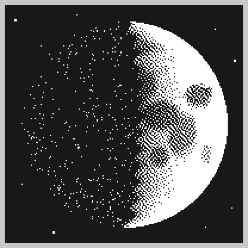

# 🌕 月の画面（天体写真のような月）

## 📋 概要
黒い空の真ん中に、今の満ち欠けの月を大きく描く画面です（画面2: Moon）。月の海・クレーター・ティコから出る光の筋を白黒の点の濃さで描き、天体写真のように見せます。数字は出しません。

満ち欠けは NTP で合わせた時刻から計算するので、センサーもネットの取得も使いません。

画面2には以前 Ambience（照度と騒音の生の値）がありました。画面11: Sound と画面12: Light ができたので、その番号を使っています。

---

## 🎨 デザイン

上弦のころ（月齢 7 日ごろ）：



- 星（四隅に少し）
- 光っている側（白）。海は点の多い灰色
- 明暗の境目は、山の影でぎざぎざ
- 影の側は地球照のまばらな点

### 見方

| 月齢の目安 | 名前 | 画面 |
|---|---|---|
| 0日 | 新月 | 地球照の点だけ（月の丸い形がうっすら分かる） |
| 3日ごろ | 三日月 | 右の縁が細く光る |
| 7日ごろ | 上弦 | 右半分が光る |
| 11日ごろ | 十日夜〜十三夜 | 左の縁だけが影 |
| 15日ごろ | 満月 | 全体が光り、海（うさぎの模様）がいちばんよく見える |
| 22日ごろ | 下弦 | 左半分が光る |
| 26日ごろ | 有明月 | 左の縁が細く光る |

- 北半球（日本）から見た向きで描きます。満ちていくときは右から、欠けていくときは左から光ります
- 時刻が合う前（NTP で同期する前）は、影だけの月（新月と同じ）に白い「?」を出します

---

## 🔭 満ち欠けの計算

月と太陽の離角（0 = 新月、90° = 上弦、180° = 満月、270° = 下弦）を、Meeus『天文計算』の簡単な式で出しています（`moonElongation()`）。平均の月齢に、月の動きの主な揺れ6つ（月の軌道が楕円であることなど）を足す式です。

- 平均の月齢だけだと、本当の新月・満月と最大で半日ほどずれます。この式なら数十分以内です
- 既知の新月・満月の時刻で確かめた結果（ずれは離角で 0.15° 以内、時刻にして約20分以内）

  | 日時（UTC） | 本当の位相 | 計算した離角 |
  |---|---|---|
  | 2024-01-11 11:57 | 新月 | 359.92° |
  | 2024-01-18 03:53 | 上弦 | 90.07° |
  | 2024-01-25 17:54 | 満月 | 179.85° |
  | 2024-02-02 23:18 | 下弦 | 269.86° |
  | 2025-09-21 19:54 | 新月 | 359.94° |
  | 2025-10-07 03:47 | 満月 | 179.89° |

- 計算は float だけで行い、角度は 360° で割った余りにしません（`fmodf` を入れると Flash が約 450 バイト増えるため）。2040年でも離角の誤差は 0.01° 程度です
- 画面13: Tide の小さな月と潮回りは、今までどおり平均の月齢（`NEW_MOON_2000` から）で出しています

---

## 🔧 技術実装

### ヘッダー宣言 (`display_screens.h`)
```cpp
// 画面2: Moon（天体写真のような月。黒い空の真ん中に、今の満ち欠けの月を大きく描く）
// 満ち欠けは now から計算する。synced が false（NTP で時刻が合う前）なら、影だけの月に「?」を出す
void displayMoon(time_t now, bool synced);
```

### 描画 (`display_screens.cpp`)

画像は持たず、1px ずつ明るさを式で計算して、Atkinson の誤差拡散で白黒の点にします（`drawRealMoon()`）。

| 部品 | 描き方 |
|---|---|
| 月 | 中心 (100, 100)、半径 86px。背景は黒 |
| 月の海 | 17個の楕円（危機の海・静かの海・晴れの海・雨の海・嵐の大洋など。`MOON_MARIA`）。楕円の中ほど暗く、0.7〜1.2倍でなめらかに明るくなる。縁は5つの波で崩して、本物の海のような形にする |
| 地面のむら | 細かい波2つで、明るさを少し上下させる |
| 小さなクレーター | 60個。決まった種の乱数で、毎回同じ位置に作る。中は暗く、縁は明るい |
| ティコの光の筋 | ティコから14本。遠いほど太く、薄くなる |
| 明るいクレーター | ティコ・コペルニクス・ケプラー・アリスタルコス（`MOON_SPOTS`） |
| 光の当たり方 | 月の地面は斜めから照らされても暗くなりにくいので、Lommel-Seeliger の式（2μ0 / (μ0 + μ)）にする。点にすると暗く見えるので、平方根で持ち上げる |
| 明暗の境目 | 境目の近くだけ、波で少しずらしてぎざぎざにする（山の影） |
| 白黒の点 | 光っている側は Atkinson の誤差拡散（誤差の 1/8 ずつを右の2つ、下の行の3つ、2行下の1つに配る）。誤差は3行分だけ持つ |
| 地球照 | 影の側は、決まった並びの乱数で点を打つ（明るさ 1 の地面で約 4%。海は少なくなる） |
| 星 | 月の外の四隅に9個（1px と 2px） |
| 「?」 | 時刻が合う前だけ。月日画面の丸ゴシックの「?」（`drawGlyph()`）を白で |

#### 速さ

ESP32-C3 は小数（float）の計算を回路でできず、ソフトで計算します。はじめに float で書いたら、実機で描くのに約 4.5 秒かかりました（その間は画面の切り替えも設定ページも止まる）。

そこで、1px ごとの計算をすべて整数にしています（明るさは 256 = 1、長さは px × 256 などの固定小数点）。sin・平方根・光の強さは描くたびに小さな表を作って引き、波は 1px 進むごとに位相を足すだけにしています。実機で描く時間は **約 0.18 秒** です（2026-10-18、上弦のころに測定）。

表と作業領域（約 3KB。`MoonWork`）は、スタックに置かずに描くたびに確保して返します。確保できなかったときは月を描きません（星だけ）。

主な定数（`display_screens.cpp`）: `MOON_R`（月の半径）、`MOON_EARTHSHINE`（地球照の点の割合）、`MOON_CRATERS` / `MOON_RAYS`（クレーターと光の筋の数）、`MOON_MARE_DARK`（いちばん暗い海で引く明るさ）、`MOON_MARIA`（海の位置・大きさ・暗さ）。

### 呼び出し (`main.cpp`)
```cpp
case 2:
  // Moon（天体写真のような月。時刻が合う前は影だけの月に「?」）
  displayMoon(time(nullptr), isTimeSynced());
  break;
```

画面2は Ambience の番号をそのまま使っています。表示する／しないの設定（`screen_mask` の2番目のビット）も引き継ぐので、設定ページで Ambience を表示しない設定にしていた場合は、Moon も表示されません（設定ページでチェックを入れる）。

---

## 📦 容量

この画面を足す前の main（`298116d`）と比べた値です（Ambience を外した分を含む）。

| | main | この画面に置き換え | 差 |
|---|---|---|---|
| Flash | 964,342 B | 968,098 B | **+3,756 B** |
| RAM | 47,500 B | 47,500 B | **±0 B** |

描くときだけ、ヒープから約 3KB（`MoonWork`）を借りて返します。

---

## ✅ 確認状況

- ✅ ビルドが通ること
- ✅ PC 上で、実際の描画コードを PC 用にビルドし、新月から一周（2024-01-11〜02-06 の8つの日時）と、時刻が合う前の画面を描いて、満ち欠けの向きと海の見え方が合っていること
- ✅ 整数で書き直した後も、float 版と同じ絵になること（PC 上で比較）
- ✅ 実機に書き込み、`Screen 3/14`（画面2）を描くのに約 0.18 秒で、リセットやエラーが出ないこと
- ✅ 実機での表示（2026-10-18、目視）
