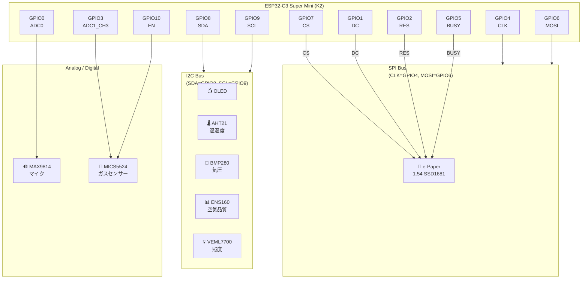

# XI-1: ESP32-C3 マルチセンサーディスプレイ

環境センサーデータをリアルタイム表示する IoT デバイス。複数のセンサーを統合し、e-Paper ディスプレイに直感的に表示します。

## 🎯 機能概要

- **マルチセンサー統合**: 6種類のセンサーから環境データを取得
- **e-Paper ディスプレイ**: WeAct 1.54" (200×200px) に見やすく表示
- **WiFi + NTP**: インターネット接続による正確な時刻管理
- **設定ページ**: WiFi に接続できないときは本体が AP になり、スマホや PC から WiFi や各種設定を変更できる
- **天気予報**: 設定ページで選んだ地域の今の天気と、今日・明日の予報を表示（Open-Meteo。API キー不要）
- **複数画面表示**: 10秒（設定ページで変更可）ごとに異なる情報を自動切り替え

---

## 📐 回路図

### 🔌 ピン配置（ESP32-C3 Super Mini）



### 📌 ピン接続表

| 機能 | GPIO | ピン用途 | デバイス |
|------|------|---------|---------|
| **I2C SDA** | GPIO8 | I2C データ | 温湿度・気圧・空気品質・光 |
| **I2C SCL** | GPIO9 | I2C クロック | 温湿度・気圧・空気品質・光 |
| **SPI CLK** | GPIO4 | SPI クロック | e-Paper |
| **SPI MOSI** | GPIO6 | SPI データ | e-Paper |
| **e-Paper CS** | GPIO7 | Chip Select | WeAct 1.54" SSD1681 |
| **e-Paper DC** | GPIO1 | Data/Command | WeAct 1.54" SSD1681 |
| **e-Paper RES** | GPIO2 | リセット | WeAct 1.54" SSD1681 |
| **e-Paper BUSY** | GPIO5 | Busy Signal | WeAct 1.54" SSD1681 |
| **マイク入力** | GPIO0 | ADC0 | MAX9814 マイク |
| **ガスセンサー入力** | GPIO3 | ADC1_CH3 | MICS5524 ガス検出 |
| **ガスセンサー EN** | GPIO10 | Digital Out | MICS5524 ヒーター制御 |

### 📡 I2C デバイスアドレス

| センサー | I2C アドレス |
|---------|-------------|
| ENS160 (空気品質) | 0x53 |
| AHT21 (温湿度) | 0x38 |
| BMP280 (気圧) | 0x76 / 0x77 |
| VEML7700 (光) | 0x10 |

---

## 🖥️ ディスプレイ情報

| 項目 | スペック |
|------|---------|
| 型番 | WeAct 1.54" e-Paper |
| インターフェース | SPI |
| ドライバ IC | SSD1681 |
| 解像度 | 200 × 200 px |
| リフレッシュ | 部分更新＋10分ごとのフルリフレッシュ |
| 更新周期 | 10秒（設定ページで変更可） |

---

## 📊 表示画面一覧

| 画面 | 内容 | データソース |
|------|------|------------|
| **0: Air Quality** | eCO2・TVOC・AQI | ENS160 |
| **1: Climate** | 温度・湿度・気圧・高度 | AHT21・BMP280 |
| **2: Ambience** | 照度・マイク音量 | VEML7700・MAX9814 |
| **3: Gas Sensor** | Rs/Ro（起動後3分間は Warming up） | MICS5524 |
| **4: Date & Time** | 現在時刻（既定で無効） | NTP同期 |
| **5: Month Day** | 月日表示 | NTP同期 |
| **6: WiFi QR** | WiFi QR コード（中央に WiFi マーク。AP モード中は本体の AP） | WiFi接続情報 |
| **7: Climate Modern** | 温度・湿度の円形ゲージ＋過去24時間グラフ | AHT21・BMP280 |
| **8: Settings QR** | 設定ページの URL の QR コード（中央に歯車） | 本体の IP アドレス |
| **9: Weather** | 今の天気・気温と、今日・明日の天気・最高/最低気温・降水確率 | Open-Meteo（地域は設定ページで選ぶ） |
| **10: Pressure** | 天気図風の H/L と等圧線（線の本数＝1013 hPa からの差）＋3時間の気圧の傾向 | BMP280 |

画面10の見方は [PRESSURE_SCREEN.md](PRESSURE_SCREEN.md) を参照。

---

## ⚙️ セッティング

### 1️⃣ WiFi 設定

本体の画面に出る QR コードをスマホで読み取り、設定ページで WiFi を選んでパスワードを入力します。

1. 保存済みの WiFi に接続できないとき（未設定のとき、または 10秒×3回続けて失敗したとき）、本体が AP「XI-1-XXXX」（パスワードなし。XXXX は MAC アドレスの末尾）になる
2. 画面に **WiFi QR（中央に WiFi マーク）** と **設定ページの QR（中央に歯車）** が交互に表示される
3. WiFi QR を読み取って AP に接続し、続けて歯車の QR を読み取ると設定ページ（`http://192.168.4.1/`）が開く
4. 一覧から WiFi を選び、パスワードを入力して「保存」すると、再起動して接続する

- 稼働中に WiFi が切れたときは自動で再接続を試し、5分たっても戻らなければ AP モードになる
- AP モード中も5分ごとに保存済みの WiFi への再接続を試す（停電後にルーターの起動が遅れた場合など）。スマホが AP に接続している間は試さない
- WiFi に接続中も、画面8（設定ページの QR）から同じ設定ページを開ける
- 設定は ESP32 の NVS（フラッシュ上の保存領域）に保存され、電源を切っても、ファームウェアを書き直しても残る
- `include/wifi_config.h` を作っておくと（`include/wifi_config.h.example` をコピー）、設定ページで保存する前の初期値として使われる。なくてもビルドできる

### 2️⃣ 設定ページでできること

| 項目 | 内容 |
|------|------|
| WiFi | SSID（スキャン一覧から選択。一覧にない場合は手入力）とパスワード。変更すると再起動して接続 |
| 画面 | 画面ごとの表示 ON/OFF、切り替え間隔（5〜3600秒、既定10秒） |
| 時刻 | NTP サーバー（既定 `pool.ntp.org`）、タイムゾーン（POSIX 形式、既定 `JST-9`） |
| 天気の地域 | 市区町村名で候補を探して選ぶ（例: 府中市 → 東京都 府中市 / 広島県 府中市。緯度・経度が入る）。緯度・経度の直接入力も可。空欄にすると未設定 |
| 気圧 | 設置場所の標高（−500〜4000 m、既定 0 m）。画面10の気圧を海面の高さに換算するのに使う |
| ガスセンサー | 今の空気を基準値（Ro）として取り直す |
| 本体 | 再起動、初期化（保存した設定を消して既定値に戻す） |

画面の表示 ON/OFF の既定値（初回起動時・初期化後）は `src/main.cpp` の `SCREEN_DEFAULT_ENABLED` 配列:

```cpp
const bool SCREEN_DEFAULT_ENABLED[NUM_SCREENS] = {
  true,   // 画面0: Air Quality
  true,   // 画面1: Climate
  true,   // 画面2: Ambience
  true,   // 画面3: Gas Sensor
  false,  // 画面4: Date & Time (無効)
  true,   // 画面5: Month Day
  true,   // 画面6: WiFi QR
  true,   // 画面7: Climate Modern
  true,   // 画面8: Settings QR
  true,   // 画面9: Weather
  true,   // 画面10: Pressure
};
```

### 3️⃣ ビルドと書き込み

```bash
# PlatformIO でビルド＆書き込み
platformio run --target upload

# または Arduino IDE で使用
```

---

## 🔧 センサー詳細

### 🌡️ AHT21 (温湿度)
- **I2C アドレス**: 0x38
- **測定範囲**: 温度 -40～85°C、湿度 0～100%
- **用途**: 室内環境監視
- **自己発熱補正**: ガスセンサーのヒーター等で約10°C高く測れるため、`src/main.cpp` の `AHT21_TEMP_OFFSET` 分を温度から引き、湿度も同じ温度差で換算し直して表示

### 🔽 BMP280 (気圧・温度)
- **I2C アドレス**: 0x76 / 0x77
- **測定範囲**: 気圧 300～1100 hPa
- **用途**: 高度計算・気象予測

### 📊 ENS160 (空気品質)
- **I2C アドレス**: 0x53
- **測定**: eCO2、TVOC、AQI スコア
- **用途**: 室内空気品質監視

### 💡 VEML7700 (光/照度)
- **I2C アドレス**: 0x10
- **測定範囲**: 0～120,000 lux（センサーの仕様上の最大）
- **設定**: ゲイン 1/8・積分時間 100ms（この設定で約30,000 luxまで測定）。レジスタ値は名前順ではないため、ライブラリの定数 `VEML7700_GAIN_1_8` / `VEML7700_IT_100MS` で指定する
- **用途**: 環境光検知

### 🔊 MAX9814 (マイク)
- **入力**: GPIO0 (ADC0)
- **用途**: 騒音レベル測定

### 💨 MICS5524 (ガスセンサー)
- **基板**: Adafruit MiCS5524 ブレークアウト（電源 **5V**）
- **入力**: GPIO3 (ADC1_CH3)
- **ヒーター制御**: GPIO10（LOW でヒーター ON）
- **検出対象**: CO、エタノール、水素、アンモニア、メタンなどの還元性ガス（種類は区別できない）
- **用途**: 有害ガス検知
- **注意**: 5V 給電のため、ガス濃度が非常に高いと出力が 3.3V（ESP32 の入力上限）を超えることがある
- **キャリブレーション**: 起動後ヒーターが温まる3分間はウォームアップ表示。その後の空気を基準 (Ro) にするため、新鮮な空気の中で起動する。設定ページの「今の空気を基準にする」で取り直すこともできる

---

## 📡 WiFi + NTP

- **WiFi**: 接続できないときは AP モードになり、設定ページから設定する（上の「WiFi 設定」を参照）
- **NTP**: 設定ページで指定したサーバー（既定 pool.ntp.org、予備 time.nist.gov）から、指定したタイムゾーン（既定 JST-9）で自動同期
- **再同期**: ESP-IDF が3時間ごとに自動更新
- **TX Power**: 最小化設定 (11.5 dBm) で消費電力削減
- **天気**: WiFi 接続中に30分ごと（失敗したら5分後、地域を変えたらすぐ）Open-Meteo から取得（詳しくは [WEATHER_SCREEN.md](./WEATHER_SCREEN.md)）

---

## 🚀 動作フロー

```
起動 → 設定読み込み (NVS) → I2C・SPI・センサー初期化 → WiFi接続 → NTP同期 → 設定ページ起動
                                                  └ 接続できなければ AP モード（WiFi QR と設定ページ QR を交互に表示）
  ↓
初回フルリフレッシュ (約1.5秒)
  ↓
切り替え間隔（既定10秒）ごとにセンサー読み込み → 画面更新 (部分リフレッシュ)
  ↓                              （その合間に、天気の地域が設定されていれば30分ごとに天気を取得）
10分ごとにゴースト軽減のためフルリフレッシュ → ループ
```

---

## 🛠️ トラブルシューティング

### I2C デバイスが認識されない
1. ワイヤリングを確認（特に SDA/SCL）
2. シリアルモニタで I2C スキャン結果を確認
3. プルアップ抵抗 (4.7kΩ) が接続されているか確認

### e-Paper が表示されない
1. SPI ピンの接続確認 (CLK, MOSI, CS, DC, RES, BUSY)
2. ドライバ IC が SSD1681 であることを確認
3. 解像度が 200×200 px であるか確認

### センサー値が不安定
1. MICS5524 は新鮮な空気中でキャリブレーション
2. I2C 通信の安定性を確認

---

## 📚 ドキュメント

- [MULTI_SCREEN_GUIDE.md](./MULTI_SCREEN_GUIDE.md) - 画面カスタマイズ方法
- [SENSOR_DATA_PASSING.md](./SENSOR_DATA_PASSING.md) - センサーデータ構造
- [VEML7700_QUICK_START.md](./VEML7700_QUICK_START.md) - 光センサー設定
- [VEML7700_INTEGRATION.md](./VEML7700_INTEGRATION.md) - 光センサー統合
- [MICS5524_INTEGRATION.md](./MICS5524_INTEGRATION.md) - ガスセンサー統合
- [WIFI_QR_SCREEN.md](./WIFI_QR_SCREEN.md) - WiFi QR コード画面
- [MONTHDAY_SCREEN.md](./MONTHDAY_SCREEN.md) - 月日表示画面
- [WEATHER_SCREEN.md](./WEATHER_SCREEN.md) - 天気画面と地域の設定
- [AVAILABLE_FONTS.md](./AVAILABLE_FONTS.md) - 使用できるフォント
- [FONT_SYSTEM_ALTERNATIVES.md](./FONT_SYSTEM_ALTERNATIVES.md) - フォント方式の比較（U8g2 など）
- [DISPLAY_REFACTORING.md](./DISPLAY_REFACTORING.md) - 画面コード分割の設計メモ（当時）

---

## 📝 プロジェクト構成

```
XI-1/
├── platformio.ini              # ビルド設定
├── src/
│   ├── main.cpp               # メインプログラム
│   ├── display_screens.cpp    # 画面表示関数
│   ├── network.cpp            # WiFi 接続と AP モード
│   ├── web_settings.cpp       # 設定ページ（Web サーバー）
│   ├── settings.cpp           # 設定の NVS への保存・読み込み
│   ├── weather.cpp            # 天気予報の取得（Open-Meteo）
│   ├── Custom_ENS160.cpp      # 空気品質センサー
│   ├── Custom_AHT21.cpp       # 温湿度センサー
│   ├── Custom_BMP280.cpp      # 気圧センサー
│   ├── Custom_VEML7700.cpp    # 光センサー
│   ├── Custom_MICS5524.cpp    # ガスセンサー
│   └── u8g2_gfx_font_test.cpp # U8g2 フォントのテスト（別 env でのみビルド）
├── include/
│   ├── wifi_config.h          # WiFi 接続設定の初期値（任意。.example をコピー）
│   ├── wifi_config.h.example  # WiFi 設定のひな形
│   ├── display_screens.h      # 画面ヘッダ
│   ├── network.h              # WiFi 接続と AP モード
│   ├── web_settings.h         # 設定ページ
│   ├── settings.h             # 設定（NVS）
│   ├── weather.h              # 天気予報
│   ├── adc_util.h             # ADC 電圧変換（eFuse 校正）
│   ├── Custom_MAX9814.h       # マイク入力（ヘッダのみ）
│   └── Custom_*.h             # センサーヘッダ
└── README.md                  # このファイル
```

---

## 🔌 必要な部品

- ESP32-C3 Super Mini (K2)
- WeAct 1.54" e-Paper (SSD1681)
- AHT21 温湿度センサー
- BMP280 気圧センサー
- ENS160 空気品質センサー
- VEML7700 光センサー
- MAX9814 マイクプリアンプ
- MICS5524 ガスセンサー
- ジャンパーワイヤー、必要に応じてプルアップ抵抗 (4.7kΩ)

---

## 📞 ライセンス・参考資料

- GxEPD2: https://github.com/ZinggJM/GxEPD2
- ESP32-C3 公式ドキュメント
- 各センサーのデータシート

---

**最終更新**: 2025年12月2日

