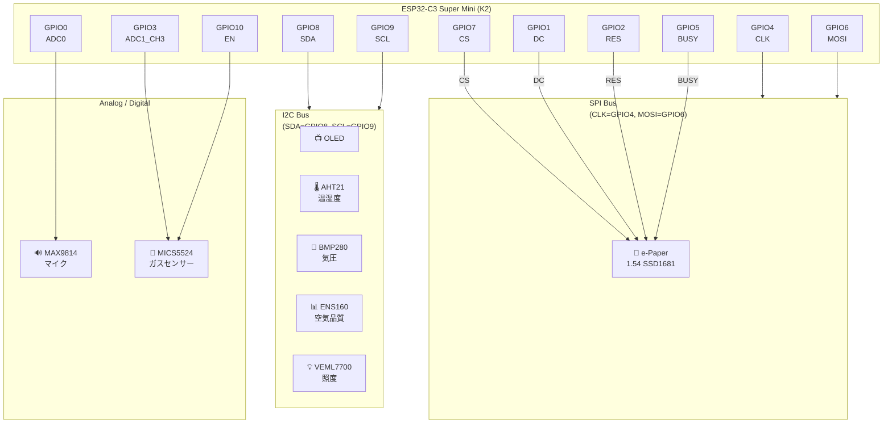

# XI-1: ESP32-C3 マルチセンサーディスプレイ

環境センサーデータをリアルタイム表示する IoT デバイス。複数のセンサーを統合し、e-Paper ディスプレイに直感的に表示します。

## 🎯 機能概要

- **マルチセンサー統合**: 6種類のセンサーから環境データを取得
- **e-Paper ディスプレイ**: WeAct 1.54" (200×200px) に見やすく表示
- **WiFi + NTP**: インターネット接続による正確な時刻管理
- **複数画面表示**: 10秒ごとに異なる情報を自動切り替え

---

## 📐 回路図

### 🔌 ピン配置（ESP32-C3 Super Mini）



### 📌 ピン接続表

| 機能 | GPIO | ピン用途 | デバイス |
|------|------|---------|---------|
| **I2C SDA** | GPIO8 | I2C データ | 温湿度・気圧・空気品質・光 |
| **I2C SCL** | GPIO9 | I2C クロック | 温湿度・気圧・空気品質・光 |
| **SPI CLK** | GPIO4 | SPI クロック | e-Paper |
| **SPI MOSI** | GPIO6 | SPI データ | e-Paper |
| **e-Paper CS** | GPIO7 | Chip Select | WeAct 1.54" SSD1681 |
| **e-Paper DC** | GPIO1 | Data/Command | WeAct 1.54" SSD1681 |
| **e-Paper RES** | GPIO2 | リセット | WeAct 1.54" SSD1681 |
| **e-Paper BUSY** | GPIO5 | Busy Signal | WeAct 1.54" SSD1681 |
| **マイク入力** | GPIO0 | ADC0 | MAX9814 マイク |
| **ガスセンサー入力** | GPIO3 | ADC1_CH3 | MICS5524 ガス検出 |
| **ガスセンサー EN** | GPIO10 | Digital Out | MICS5524 ヒーター制御 |

### 📡 I2C デバイスアドレス

| センサー | I2C アドレス |
|---------|-------------|
| ENS160 (空気品質) | 0x53 |
| AHT21 (温湿度) | 0x38 |
| BMP280 (気圧) | 0x76 / 0x77 |
| VEML7700 (光) | 0x10 |

---

## 🖥️ ディスプレイ情報

| 項目 | スペック |
|------|---------|
| 型番 | WeAct 1.54" e-Paper |
| インターフェース | SPI |
| ドライバ IC | SSD1681 |
| 解像度 | 200 × 200 px |
| リフレッシュ | 部分更新＋10分ごとのフルリフレッシュ |
| 更新周期 | 10秒 |

---

## 📊 表示画面一覧

| 画面 | 内容 | データソース |
|------|------|------------|
| **0: Air Quality** | eCO2・TVOC・AQI | ENS160 |
| **1: Climate** | 温度・湿度・気圧・高度 | AHT21・BMP280 |
| **2: Ambience** | 照度・マイク音量 | VEML7700・MAX9814 |
| **3: Gas Sensor** | ガス濃度・抵抗値 | MICS5524 |
| **4: Date & Time** | 現在時刻 | NTP同期 |
| **5: Month Day** | 月日表示 | NTP同期 |
| **6: WiFi QR** | WiFi QR コード | WiFi接続情報 |

---

## ⚙️ セッティング

### 1️⃣ WiFi 設定

`include/wifi_config.h` ファイルを編集:

```cpp
#define WIFI_SSID "YOUR_SSID"
#define WIFI_PASSWORD "YOUR_PASSWORD"
```

サンプル: `include/wifi_config.h.example` を参照

### 2️⃣ 画面表示の有効/無効

`src/main.cpp` の `SCREEN_ENABLED` 配列を編集:

```cpp
const bool SCREEN_ENABLED[NUM_SCREENS] = {
  true,   // 画面0: Air Quality
  true,   // 画面1: Climate
  true,   // 画面2: Ambience
  true,   // 画面3: Gas Sensor
  false,  // 画面4: Date & Time (無効)
  true,   // 画面5: Month Day
  true,   // 画面6: WiFi QR
};
```

### 3️⃣ ビルドと書き込み

```bash
# PlatformIO でビルド＆書き込み
platformio run --target upload

# または Arduino IDE で使用
```

---

## 🔧 センサー詳細

### 🌡️ AHT21 (温湿度)
- **I2C アドレス**: 0x38
- **測定範囲**: 温度 -40～85°C、湿度 0～100%
- **用途**: 室内環境監視
- **自己発熱補正**: ガスセンサーのヒーター等で約10°C高く測れるため、`src/main.cpp` の `AHT21_TEMP_OFFSET` 分を温度から引き、湿度も同じ温度差で換算し直して表示

### 🔽 BMP280 (気圧・温度)
- **I2C アドレス**: 0x76 / 0x77
- **測定範囲**: 気圧 300～1100 hPa
- **用途**: 高度計算・気象予測

### 📊 ENS160 (空気品質)
- **I2C アドレス**: 0x53
- **測定**: eCO2、TVOC、AQI スコア
- **用途**: 室内空気品質監視

### 💡 VEML7700 (光/照度)
- **I2C アドレス**: 0x10
- **測定範囲**: 0～120,000 lux
- **用途**: 環境光検知

### 🔊 MAX9814 (マイク)
- **入力**: GPIO0 (ADC0)
- **用途**: 騒音レベル測定

### 💨 MICS5524 (ガスセンサー)
- **入力**: GPIO3 (ADC1_CH3)
- **ヒーター制御**: GPIO10
- **検出対象**: CO、NH3、NO、NO2 ほか
- **用途**: 有害ガス検知
- **キャリブレーション**: 起動後ヒーターが温まる3分間はウォームアップ表示。その後の空気を基準 (Ro) にするため、新鮮な空気の中で起動する

---

## 📡 WiFi + NTP

- **WiFi**: インターネット接続で QR コード表示可能
- **NTP**: pool.ntp.org より JST (UTC+9) を自動同期
- **再同期**: 24時間ごと自動更新
- **TX Power**: 最小化設定 (11.5 dBm) で消費電力削減

---

## 🚀 動作フロー

```
起動 → I2C・SPI・センサー初期化 → WiFi接続 → NTP同期
  ↓
初回フルリフレッシュ (約1.5秒)
  ↓
10秒ごとにセンサー読み込み → 画面更新 (部分リフレッシュ)
  ↓
10分ごとにゴースト軽減のためフルリフレッシュ → ループ
```

---

## 🛠️ トラブルシューティング

### I2C デバイスが認識されない
1. ワイヤリングを確認（特に SDA/SCL）
2. シリアルモニタで I2C スキャン結果を確認
3. プルアップ抵抗 (4.7kΩ) が接続されているか確認

### e-Paper が表示されない
1. SPI ピンの接続確認 (CLK, MOSI, CS, DC, RES, BUSY)
2. ドライバ IC が SSD1681 であることを確認
3. 解像度が 200×200 px であるか確認

### センサー値が不安定
1. MICS5524 は新鮮な空気中でキャリブレーション
2. I2C 通信の安定性を確認

---

## 📚 ドキュメント

- [MULTI_SCREEN_GUIDE.md](./MULTI_SCREEN_GUIDE.md) - 画面カスタマイズ方法
- [SENSOR_DATA_PASSING.md](./SENSOR_DATA_PASSING.md) - センサーデータ構造
- [VEML7700_QUICK_START.md](./VEML7700_QUICK_START.md) - 光センサー設定
- [MICS5524_INTEGRATION.md](./MICS5524_INTEGRATION.md) - ガスセンサー統合

---

## 📝 プロジェクト構成

```
XI-1/
├── platformio.ini              # ビルド設定
├── src/
│   ├── main.cpp               # メインプログラム
│   ├── display_screens.cpp    # 画面表示関数
│   ├── Custom_ENS160.cpp      # 空気品質センサー
│   ├── Custom_AHT21.cpp       # 温湿度センサー
│   ├── Custom_BMP280.cpp      # 気圧センサー
│   ├── Custom_VEML7700.cpp    # 光センサー
│   ├── Custom_MICS5524.cpp    # ガスセンサー
│   └── Custom_MAX9814.cpp     # マイク入力
├── include/
│   ├── wifi_config.h          # WiFi 接続設定 ⭐ 要編集
│   ├── display_screens.h      # 画面ヘッダ
│   └── Custom_*.h             # センサーヘッダ
└── README.md                  # このファイル
```

---

## 🔌 必要な部品

- ESP32-C3 Super Mini (K2)
- WeAct 1.54" e-Paper (SSD1681)
- AHT21 温湿度センサー
- BMP280 気圧センサー
- ENS160 空気品質センサー
- VEML7700 光センサー
- MAX9814 マイクプリアンプ
- MICS5524 ガスセンサー
- ジャンパーワイヤー、必要に応じてプルアップ抵抗 (4.7kΩ)

---

## 📞 ライセンス・参考資料

- GxEPD2: https://github.com/ZinggJM/GxEPD2
- ESP32-C3 公式ドキュメント
- 各センサーのデータシート

---

**最終更新**: 2025年12月2日

